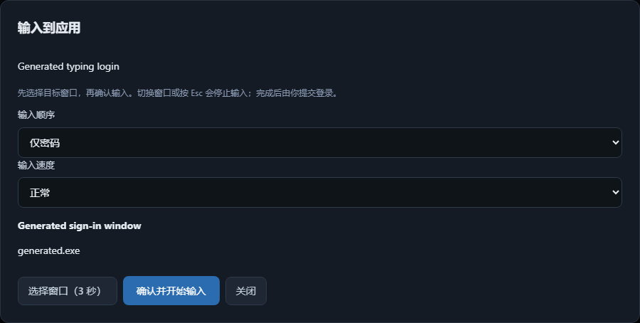

# Type a login into a Windows application

Open a saved login or **Quick search / 快捷搜索** and choose **Type into application /
输入到应用**. Save or discard an editor draft first. Choose the sequence:

- Username → Tab → Password (default)
- Username only
- Password only

Choose **Choose window (3 seconds) / 选择窗口（3 秒）**. Vault Unified hides briefly;
switch to the application and click the first field within three seconds. The
vault returns showing the selected window title and executable name. Check them,
then **Confirm and start typing / 确认并开始输入**. Check the completed fields in the
application and submit the login yourself. Input is literal: `{ENTER}` in a
credential is text, not a command.

Changing foreground windows, pressing Esc or a modifier key, locking the vault,
or cancelling stops the operation. Existing partial input stays in the target;
inspect it before retrying. A selection expires after 60 seconds and can be used
only once. Slow applications can use the slower speed. Each field accepts up to
256 characters, without control characters, and an operation stops after 30
seconds. Windows elevated applications may reject input; use an ordinary window
or copy the individual fields.

## Implementation and validation

Selection retains a native window handle, process handle/ID and title in memory.
The retained process handle prevents PID reuse. The actual handle/process/title
is checked again before typing and between characters. A Win32 foreground event
hook also records transient departures, so switching away and back does not
resume the remaining sequence. The native worker owns the hook's message loop.
Each Unicode character uses one SendInput group; only the chosen Tab is added.
Clipboard contents are never changed and Enter is never injected.

The native worker fetches saved fields over the native-only loopback endpoint
after confirmation, using the current vault session. It accepts only exact entry
IDs and active login entries, excluding trash/archive/deleted entries. Values
stay out of the renderer command and error messages, and no-store responses and
zeroized temporary Rust field buffers are used. There is no vault-format change,
new permission registry, persistent target profile or synchronization metadata.

Backend tests cover authorization, inactive/non-login/malformed data, control
characters, missing IDs, locked sessions and absence of vault writes. Rust tests
cover sequence validation and literal text. Bilingual renderer tests cover
confirmation, target display, failure, cancellation, keyboard search integration,
accessibility and scanned artifacts. The actual Windows executable drives an
isolated WinForms target using generated credentials; it verifies Unicode and
literal braces, Tab, no submit, one-use selection, focus diversion with an empty
second window, explicit cancellation and changed-title refusal.

Native test windows and their controls are created solely for this journey; no
real application, login or clipboard is inspected. Final installed acceptance
repeats the flow in a test account's normal client application, including slow
mode, Esc cancellation and a deliberately changed destination.

Win32 references: [SendInput](https://learn.microsoft.com/en-us/windows/win32/api/winuser/nf-winuser-sendinput),
[foreground event hooks](https://learn.microsoft.com/en-us/windows/win32/api/winuser/nf-winuser-setwineventhook).

Rollback: revert the increment and restart. No saved vault data or application
credentials are modified by automatic typing.
