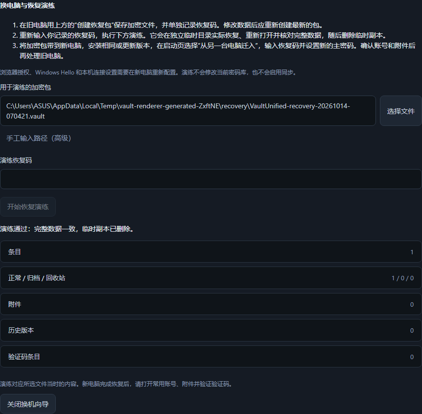

# Move to another computer

1. On the old computer, open **Security & recovery → Emergency recovery kit**.
   Create a recovery code, record it separately, re-enter it and save the encrypted
   kit. The most recently created path stays visible on this page. Create a fresh
   kit if the vault changes before the move.
2. Open **Move computers and rehearse recovery**. Select the kit (the newest path
   is suggested), re-enter the recorded code and rehearse. The result lists entry,
   archive/trash, attachment, history and authenticator counts. It proves recovery
   of that file at that time; it does not claim the file includes later edits.
3. Move the encrypted file to the new computer, keeping its code separately.
   Install the same or a newer Vault Unified version. On startup choose **Bring a
   vault from another computer**, select the kit, enter its code and choose a new
   master password. Preview the entry count and destination impact before
   confirming. Cancel leaves the destination unchanged.
4. Unlock with the new password and open a few accounts, attachments and
   authenticator codes. Configure local connection settings, browser trust and
   Windows Hello again. Keep the old computer until these checks pass.

The encrypted kit uses the existing v3 recovery format and preserves complete
schema-2/schema-3 payloads, including entry extensions, histories, attachments and
vault metadata. It contains no local Windows Hello or browser device keys. This
workflow does not enable synchronization.

Rehearsal uses the production recovery writer with a new random temporary master
password, a bounded snapshot of the encrypted source, and a separate generated
temporary directory. It reopens the output and compares the entire decrypted
payload before reporting counts. Only encrypted files are written. The temporary
directory is removed on success or failure; cleanup failure is a failed rehearsal.
The active vault, sessions, configuration and recovery kit are never replaced.
No extra baseline registry, permanent validation file or hashing workflow exists.

Actual migration reuses the existing single-use preview and atomic recovery
confirmation, including source/destination change detection and retained encrypted
pre-recovery copies. The local desktop bootstrap is required for pre-unlock
rehearsal; browser pairing tokens cannot access it. Responses contain counts only,
use no-store and never echo input credentials or internal failure details.

Seven backend cases cover actual round-trip preservation, schema 2, a new computer,
wrong credentials, corrupt packages, partial writes, discarded metadata and
cleanup. Bilingual renderer journeys create a kit, rehearse, cancel a migration
preview, then recover into a second independent API/profile and unlock with a new
password. Existing recovery journeys remain covered. Native picker/installer
lifecycle is exercised separately during stage 7 delivery.

