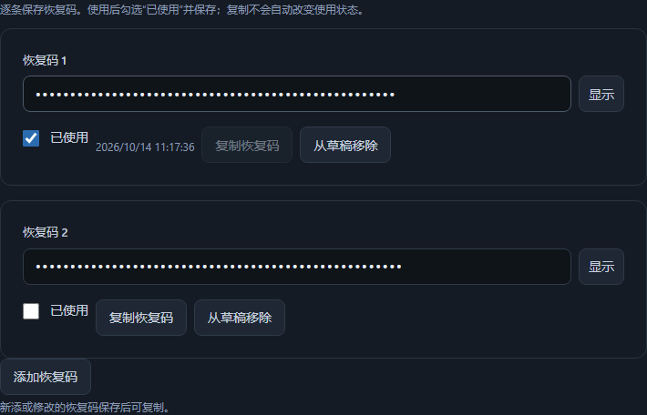

# Credential templates

Create an entry and choose **Recovery codes**, **Software license**, or
**API credential** under **Content type**. Existing vaults need the backed-up
personal-format upgrade in Security & recovery before creating these templates.
New vaults already use that format.

中文：添加条目后，在 **内容类型** 中选择 **恢复码**、**软件许可证** 或
**API 凭据**。旧密码库先在 **安全与恢复** 中完成保留备份的格式升级。

- Recovery codes: enter individual codes, save, then copy an unused code when
  needed. After using one, check **Used** and Save. Copying never marks a code
  used. Cancelling/discarding leaves the saved status untouched. Editing a code
  requires saving before its copy action becomes available.
- Software license: license key, registered name/email and optional expiry date.
- API credential: token/key, environment, scopes and optional expiry date.

The primary secret is concealed by default. Revealed fields hide after 30 seconds,
window blur or visibility change. Used-code timestamps remain visible. History
compares template values in readable labels and supports restoring them through
the ordinary draft/Save flow. Old recovery-code entries retain their legacy
password/notes; no unstructured notes are automatically parsed.

Template data uses encrypted `vault_unified:template` version 1 metadata inside
payload schema 3. Maximum 100 distinct codes per entry, each at most 1024
characters. License/API primary keys use the existing encrypted password field.
Only login entries qualify for browser matching. Concealed API listings/history
responses do not contain template values; validation errors omit submitted values.

JSON export is now transfer version 2; readers also accept version 1. CSV stores
template details as JSON in `template_data`. Updating from an older export that
lacks this field preserves current template details; an explicit empty object
clears them. Bad CSV template JSON is an item-level preview error. Plaintext
transfer still excludes archive/trash, history and CSV attachment binaries;
encrypted backups and recovery packages retain the complete vault.

Generated validation covers used/copy state, history, write failure, concealed
responses, invalid-data redaction, JSON/CSV round trips, old import compatibility,
old-format refusal without changes, encrypted recovery, and both UI languages.
The clipboard API is replaced with an in-memory recorder in unit tests; the
renderer tests do not modify the operator's clipboard.

Rollback requires retaining a current encrypted backup and a template-capable
client to read all fields. Released v1.3 clients reject payload schema 3. The
pinned pre-upgrade copy remains available for returning to the older application,
but predates later edits.
