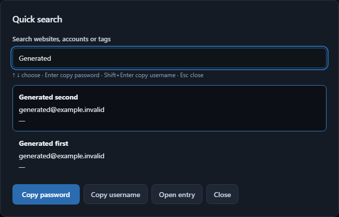

# Quick search and tray

Press **Ctrl+Shift+Space** from another Windows application to open Vault Unified.
If the vault is locked, unlock it first; search opens after unlocking. Inside the
window, use **Ctrl+K** or the **Quick search / 快捷搜索** button.

- Type a website, title, username or tag. Favorites appear first, then recently
  updated entries. Search shows up to 20 active entries; archive and trash stay out.
- Use Up/Down to select, Enter to copy the password, Shift+Enter to copy the
  username, and Escape to close. Copy uses the existing conditional 45-second
  clipboard clear. Search results contain no credential values.
- **Open entry / 打开条目** opens the selected editor. An unsaved editor draft
  requires a discard decision before changing entries.

Closing the main window normally keeps the app in the Windows tray. Click its
icon to reopen it, or use its menu to search, lock or quit. Hidden windows retain
drafts until the existing automatic lock clears them. Explicit Quit still checks
for unsaved changes and waits for an ongoing Save.

In **Settings → Quick search and tray / 设置 → 快捷搜索与托盘**, change or disable
the global shortcut and change the close behavior. If Windows cannot register a
shortcut, the app remains usable and settings explains how to choose another.
If the tray cannot be created, closing the window follows the exit confirmation
flow. Starting the application again reopens the running instance.

## Implementation and validation

The existing main webview and authenticated API session are reused. No bearer
token is copied to another webview. Native UI preferences contain only locale,
shortcut and close behavior; malformed preferences return to defaults. Vault
content and encryption are unchanged. New native commands accept the main window
only. The global-shortcut plugin needs Tauri 2.12; the lockfile includes that update.

Renderer journeys cover both languages, keyboard selection/copy, empty results,
draft cancellation, locked search handoff, shortcut conflicts and explicit exit.
Accessibility and generated-artifact scanning cover the search dialog. The native
journey uses a separate application identifier, generated vault and WebView2
profile, and exercises the actual Windows process. Installer and tray-menu manual
acceptance remain part of the final delivery stage.

Local results: 15 distinct renderer journeys passed across focused runs (three
new, twelve editor regressions), four Rust tests, seven CI/release contract tests,
TypeScript/build and the repository secret scan. The native lifecycle journey
passed close-to-tray, a real shortcut from another generated window, second-launch
focus, dirty-exit cancellation, restart/unlock, preference persistence, shortcut
disable/re-enable, actual blob QR decoding and sidecar termination. CI reruns the
native journey on the proposed commit. Its native GUI job uses Windows Server
2022 while the other jobs use the latest runner. Server 2025 currently has an
[upstream WebView2 automation failure](https://github.com/actions/runner-images/issues/14738)
before the debugging endpoint opens; the runtime is not downgraded or pinned.
Local native acceptance also passed on Windows 11.

The native content policy also permits local blob images, allowing the existing
offline TOTP QR image reader to decode a selected image in the packaged webview.

## Acceptance steps

1. Create a test account, close the window and reopen it with the global shortcut.
2. Copy username/password with the keyboard and confirm conditional clipboard
   clearing. Try a query with no results and an archived account.
3. Leave a draft, close/reopen the window, then try Quit and choose Keep editing.
4. Lock from the tray, invoke search, unlock and select the account.
5. Change the shortcut, turn close-to-tray off, quit and restart. Confirm the
   preferences survive and the vault starts locked.
6. Start a second copy; verify the first window returns and no second vault
   process starts. Choose Quit from the tray and verify the sidecar exits too.

Reverting this increment restores the previous window behavior. Its non-secret
preference file can remain; no vault-format rollback is necessary.
