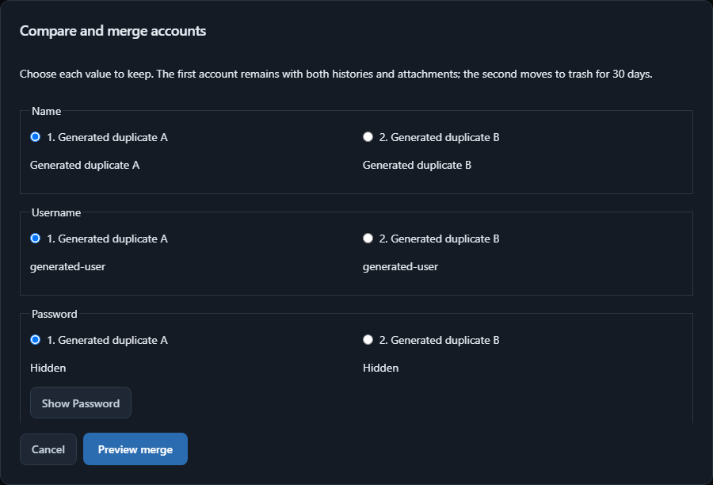

# Duplicate account merge

In **Passwords → Filters and bulk organization**, enable **Duplicates only**.
Select two accounts, choose **Compare and merge**, choose the value to keep for
each field, then preview and confirm. The first account remains; the second
moves to trash for 30 days. Closing or cancelling performs no write.

中文：**密码 → 筛选与批量整理 → 仅重复账号**，选中两条账号，再点
**比较并合并**。逐字段选择保留值，预览后确认。第一条账号保留，第二条移入
回收站并保留 30 天。

Candidates require active login entries with the same exact website host/port
and username, or the same name/username when neither has a website. Username
case is preserved; empty usernames, archived/trash items, notes and credentials
for different hosts or ports are excluded. No merge is automatic.

The comparison initially conceals passwords, notes, custom values and TOTP
secrets. Explicit reveal hides after 30 seconds, blur or visibility change.
Both current versions and all existing histories remain available in the kept
entry's history comparison. Merged versions are encrypted in the schema-3
`vault_unified:merged_history` namespace, separate from the 20-version rolling
edit history, and survive later edits, backups and recovery. The merge refuses
more than 10,000 retained versions rather than dropping any.

Attachments from both accounts are retained, with identical file/name/type
deduplication and identifier collision repair. Existing per-entry attachment
limits apply; exceeding them refuses the entire merge. Each original external
source association remains with its original entry.

Preview binds both entry IDs, field choices and the current vault state to the
existing session-scoped preview store. Apply consumes that preview and commits
both changes in one existing atomic batch. Cancellation, altered choices,
concurrent edits and replay cannot partially merge or remove an account.

Generated-data tests cover both histories at the ordinary retention limit,
later edits, restoring old fields, encrypted reopening, concealed responses,
attachment collisions/limits, exact duplicate detection, cancellation, stale or
repeated apply, legacy format refusal and disk-write failure. The real API
renderer journey covers field choice, cancel, persistence and trash recovery,
with accessibility and secret-artifact scans.

Rollback: retain a current encrypted backup and use a client with merge support
to access the retained history. Reverting this UI does not discard the namespace,
but earlier clients cannot display those additional versions. The schema-3
container remains incompatible with v1.3 as documented in the migration guide.
