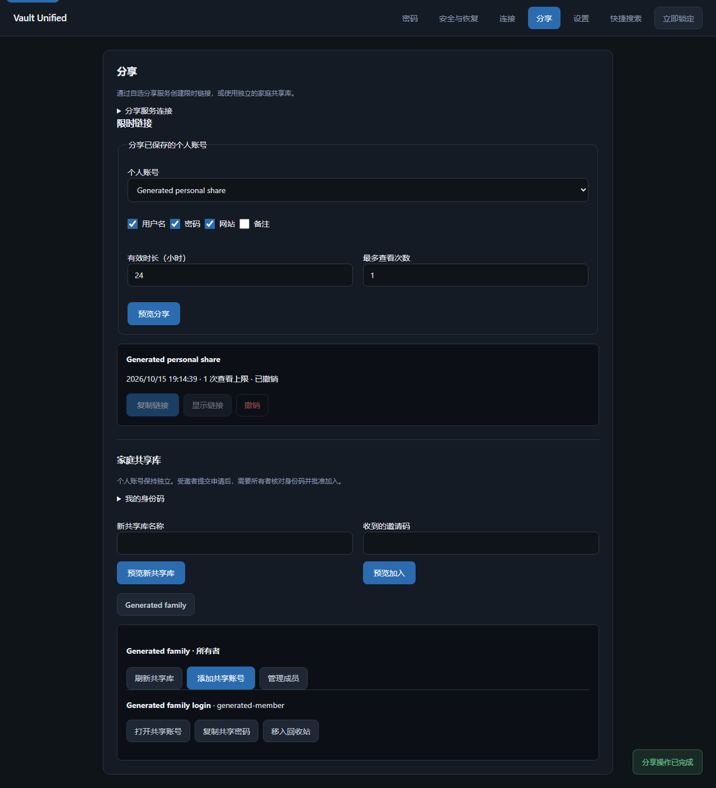
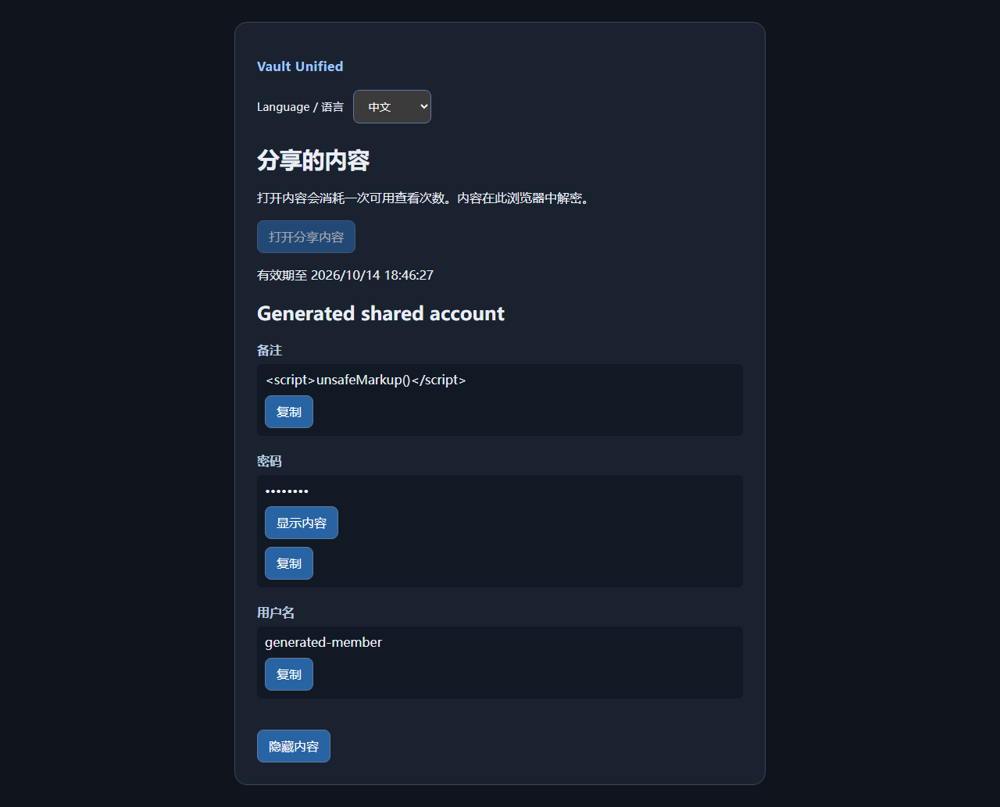

# Optional encrypted sharing / 可选加密分享

The sharing service runs separately from the desktop's loopback API. It stores
ciphertext and access metadata in SQLite; it never opens a personal vault. No
Vault Unified cloud account is needed. The desktop Sharing page manages service
connections, selected-field links and independent family vaults in Chinese/English.

## Desktop workflow / 桌面使用

Open Sharing, save the service address and its administration token. The token
stays in Windows Credential Manager; identity keys, link keys, shared accounts and
pending operations stay in the encrypted personal vault. No automatic sharing
request runs in the background. Joining an invitation does not need the token.

Choose a personal account, select its fields, expiry and view limit, then preview
and confirm. Copy the created link or revoke it from the same page. Notes are
excluded initially. Personal history and other accounts never enter the snapshot.

Create a family vault, add shared accounts, and invite readers or editors. Ask the
invitee for their identity code before approving the request. Shared accounts have
title, username, password, website and notes, 20 saved revisions and 30-day trash.
Readers can open and copy accounts; editors can change them; owners manage members.
Removing a member rotates the key. Personal accounts remain separate.

Pending writes survive restart. Retry after reconnecting. For an account conflict,
choose Review pending draft, compare the latest fields, and preview the revised
proposal. Cancelling keeps the saved draft. Discard refreshes the remote state;
an operation already accepted by the service is not undone. Cached family accounts
remain usable offline; refresh checks current membership before replacing them.

在「分享」中配置服务地址和管理令牌，然后预览创建链接或家庭库。受邀者粘贴
邀请码，所有者核对双方身份码后批准。只读成员可查看和复制，共享库与个人账号
分开。网络中断留下加密的待发送操作；发生冲突时可重新核对草稿并选择最新字段。



## Deploy / 部署

For direct execution, install `pip install '.[api]'`, create a random administration
token in a private file, then run:

```powershell
New-Item -ItemType Directory -Force deploy/sharing/secrets
python -c "import pathlib,secrets; pathlib.Path('deploy/sharing/secrets/admin-token.txt').write_text(secrets.token_urlsafe(32))"
vault-share --database data/sharing.db --admin-token-file deploy/sharing/secrets/admin-token.txt
```

The default address is `http://127.0.0.1:8788`. Keep the token file available only
to the operator and service account. Read its value privately when configuring
desktop creation; do not send it to recipients. Administration authentication is
required to create shares and families. Existing members use their own identities.

For Docker Compose, create the same token file and run from the repository root:

```sh
docker compose -f deploy/sharing/compose.yaml up --build -d
```

The container runs as a non-root user with a read-only root filesystem, a named
SQLite volume and a file-mounted administration secret. The published port binds
only to localhost. Put an HTTPS reverse proxy on that port to share outside this
computer; the viewer needs HTTPS except on localhost. Set a request-size limit
of 18 MiB and suitable rate limits in the proxy. The application also enforces
its body limit and a 256 MiB ciphertext quota. Back up the SQLite database with
SQLite's backup command/API while running, or stop the service before copying
the database and its WAL files. `down` preserves the data volume; `down --volumes`
removes it. No public domain or server is provisioned by the repository.

服务默认只监听本机。外网使用时，在服务前配置 HTTPS 反向代理。管理令牌只用于
创建分享和家庭库，不发给接收者。容器的数据卷保存加密内容，卸载容器时保留该卷
即可保留分享状态。个人密码库不上传到本服务。

## Single-item links



Each snapshot uses an independent AES-256-GCM key and a random 96-bit nonce.
Associated data binds the format and share ID. The URL fragment contains the
decryption key and a separate 256-bit read capability; fragments are not sent in
HTTP requests. The viewer immediately removes the fragment from browser history.
Only the capability is sent when the recipient explicitly opens the item. Opening
the page does not consume a view. SQLite serializes access-count decisions so a
last remaining view can be used only once, including concurrent requests.

Expiry is between one minute and 30 days; each share permits 1–100 views. Revocation,
exhaustion and expiry block later reads. Exhaustion/revocation clears the active
ciphertext; expired ciphertext is pruned during subsequent service transactions.
Rows remain for 30 days after expiry to preserve retry behavior. Server backups can
retain old ciphertext. A completed view cannot be recalled from its recipient.

The browser uses Web Crypto and local static scripts, no third-party resources,
and renders fields as text. Passwords start masked. Hiding the page, hiding content
or reaching five minutes/expiry clears visible content. Reopening the original link
can request another available view. Chinese and English are available.

## Families and membership

Families have an owner, editors and readers. They are independent encrypted
documents; personal entries are never added automatically. Identities use Ed25519
signing and X25519 key agreement. Per-member AES-GCM key envelopes derive keys
with HKDF-SHA256 and bind the group, epoch and recipient. The owner signs the whole
membership manifest; clients pin that owner's public identity from creation or the
invitation and verify the manifest before using an envelope.

An invitation is single-use, expires within seven days and specifies editor or
reader. Accepting binds the invitation to the invitee's signing/encryption keys,
but grants no access yet. The desktop verifies the invitee's signed acceptance,
including its encryption key and family binding. The owner reviews the identity and signs its
membership/key envelope. Removing a member atomically advances the epoch,
re-encrypts content, replaces every remaining member's key envelope and invalidates
outstanding invitations. The removed identity cannot read or write later versions.
Already viewed or cached old content remains with that member.

Every authenticated request signs its route, timestamp, random nonce and payload.
The server rejects stale/replayed requests and enforces roles on every operation.
Content has a separate author signature and a revision. Stale writes return a
conflict; clients must refresh and review instead of overwriting. TLS protects
the protocol and server-enforced counts/ACLs. An operator controlling the viewer's
served JavaScript is trusted by recipients using that viewer; self-host with an
operator you trust. Desktop family clients verify ciphertext and owner signatures.

## Verification and rollback

Generated tests cover actual SQLite races, read-only rejection, replay/tamper
rejection, invitation binding/expiry/revocation, owner approval, key rotation,
removed-member denial, persistent revocation and quota failure. Browser journeys
use the real HTTP service and Web Crypto in English/Chinese, with accessibility
and secret-artifact scanning. CI builds and runs the real Compose container; local
Windows development has no Docker executable. Actual Compose deployment passed
CI 38551994491. Desktop journeys use independent profiles, the real HTTP service
and Windows Credential Manager, including read-only and removed-member behavior.

Stopping this optional service leaves personal vault operation intact. Preserve
its database and the clients' encrypted identities before reverting. Database
version 2 adds signed invitation acceptance proofs. Upgrading version 1 preserves
active shares and families, but drops pending requests without proofs; those
invitees submit their invitation again. Keep a database backup before upgrading.
Version 1 service binaries refuse version 2; rollback uses that database backup.
Desktop sharing metadata is optional and retained by older payload-v3 clients.

References: [cryptography AEAD](https://cryptography.io/en/latest/hazmat/primitives/aead/),
[Web Crypto decryption](https://developer.mozilla.org/en-US/docs/Web/API/SubtleCrypto/decrypt),
[FastAPI containers](https://fastapi.tiangolo.com/deployment/docker/).
