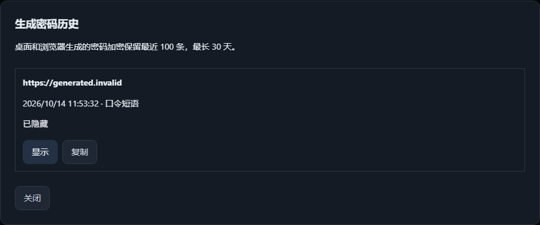

# 生成密码与找回 / Generate and recover passwords

添加或编辑登录信息时，点击「生成密码」。生成结果先加密写入历史，再进入
密码草稿；保存账号后才会替换账号原来的密码。放弃草稿也能从密码库首页
「生成密码历史」或编辑页「找回生成的密码」找回。浏览器扩展的生成结果
也保存在这份历史中，关闭扩展或重启后仍可找回。

历史保留最近 100 条、最长 30 天，默认隐藏内容。可显示、复制，或载入
当前密码草稿。显示在失焦或三十秒后隐藏，复制沿用四十五秒剪贴板清理。
历史只记录网站来源，不记录路径、查询参数或 URL 内的账号密码。

「密码生成高级选项」支持：

- 随机密码：8–128 字符，默认 20；开关大小写、数字、符号，并设置仅允许
  或排除的字符。每个启用的字符组都必须有可用字符，总共至少 10 个不同字符。
- 口令短语：默认六个英文词，可选 6–12 词和分隔符；每个词独立随机选择。
  使用本地 [EFF 长词表](https://www.eff.org/dice)，共 7,776 个词。

Old vaults retain their basic generator until **Security and recovery → Upgrade
vault format**. Personal-format vaults keep desktop and browser-generated secrets
encrypted before returning them. Recover them from **Generated password history**,
including after discarding an entry draft or restarting. Revealing, copying and
loading a draft are separate actions; loading does not save the account.

**Password generator advanced options** includes character restrictions and
offline passphrases, using six independent EFF words by default. The original
wordlist and [attribution/license](../src/vault_unified/wordlists/README.md) are
bundled in the Python package and desktop sidecar.

## Persistence and retention

The optional `vault_unified:generated_passwords` version-1 namespace belongs to
the existing encrypted schema-3 payload. The existing vault lock and atomic writer
commit it; a write failure leaves memory/disk unchanged and returns no password as
a successful result. Retried generation IDs reuse the retained result. Entry edits,
encrypted backups and recovery packages preserve the complete payload.

Expired records cannot be revealed or copied. Unlock and generation remove them
from the active encrypted payload. Previously created encrypted backups keep their
own snapshots under the existing backup policy. Plaintext entry export does not
include vault-wide generated history. Browser authorization permits generating a
new password, not reading previous generated history.

## Verification and rollback

Generated-data checks cover restrictions, all 7,776 bundled words, encrypted
restart, capacity/expiry, request retry, concurrent generation, failed writes,
cancelled drafts, English/Chinese keyboard flows, accessibility, and actual
Chromium extension generation followed by native/API restart and desktop recovery.
Installer lifecycle remains part of final delivery.

Reverting the increment preserves the optional encrypted metadata. Reinstall this
version to access it again; do not rewrite or downgrade the schema-3 vault.
