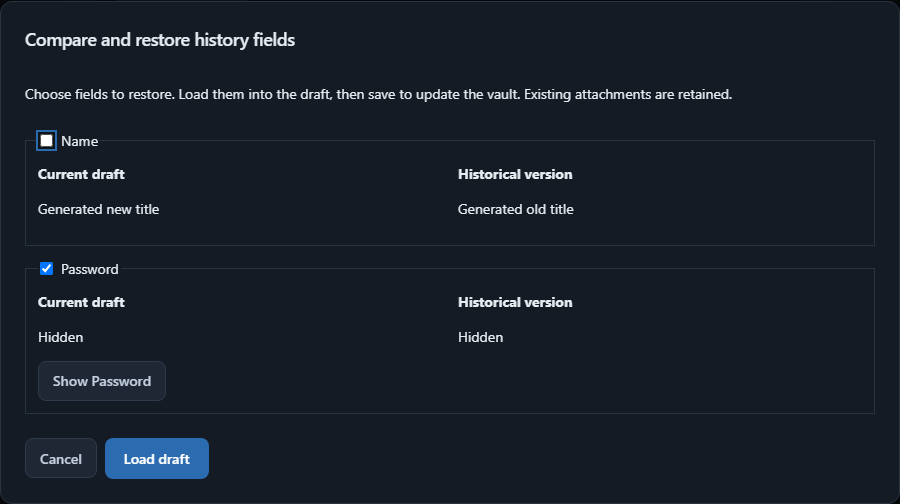

# Selective history restore

Open an entry, expand **More options**, and choose a saved version under
**History**. The comparison shows changed fields from the current draft and the
saved version. Uncheck anything you want to keep, then choose **Load draft**.
Only **Save** commits the result; cancelling the comparison or discarding the
editor leaves the vault unchanged.

中文入口：打开条目 → **更多选项** → 历史版本的 **载入草稿预览**。
对比当前草稿与历史内容，取消勾选需要保留现值的字段，再点 **载入草稿**。
保存后才修改密码库，现有附件保持不变。

Passwords, notes, authenticator keys and custom-field values are hidden initially.
Explicit reveal hides again after 30 seconds, window blur or visibility change.
The modal supports keyboard navigation, Escape to cancel and restoring focus.
An unchanged version reports that there are no fields to restore.

The existing authenticated history preview and atomic entry transaction remain
the read/write boundaries. Field selection updates the complete in-memory draft;
the original entry revision still guards Save against concurrent edits. No extra
approval token, journal or backup mechanism is introduced.

Generated-data verification covers comparison, selective password restoration
while retaining the current title, persistence after reopening the editor, Escape
without writes, reveal/blur hiding, and existing discard/failure workflows.

