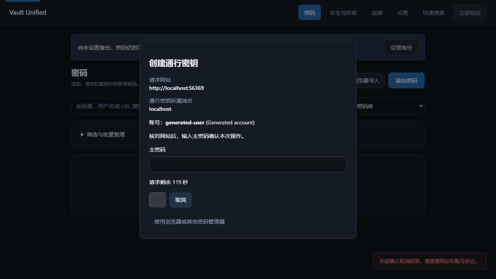

# Passkey implementation

## Current increment

The portable protocol/storage layer is merged in PR #77. The connected Chromium
extension and desktop approval flow now implement registration and sign-in in
source. The released installer remains v1.3.0 until the delivery stage.

## 使用 / Use

在扩展的「输入框内选择账号」中先开启目标网站，再勾选「在已授权网站使用
Vault Unified 通行密钥」。默认关闭，授权其他网站不会自动开启此选项。
网站发起创建或登录请求后，在桌面窗口核对网站域名和账号，输入主密码确认。
可以取消，也可以选择「使用浏览器或其他密码管理器」。已保存的通行密钥会显示
在账号编辑页，随加密备份、恢复包和多电脑同步保留。

In the extension's **Choose accounts inside fields** section, enable the website,
then select **Use Vault Unified Passkeys on authorized websites**. It is off by
default. When the website requests creation or sign-in, check its origin and
account in the desktop prompt, then confirm with your master password. Cancel or
choose another provider at any time before completion. Entry details list saved
Passkeys; encrypted backup, recovery and computer synchronization retain them.

Credentials use ES256 (P-256), random 32-byte credential IDs and RP-provided user
handles. Private keys remain in the encrypted vault's optional
`vault_unified:passkeys` entry namespace. The namespace has version 1 and an
immutable credential list. Up to 100 credentials can belong to one account.
Old schema-2 vaults must complete the existing backed-up schema-3 upgrade first.

## Protocol and trust boundary

- The trusted extension worker derives the origin from the browser's actual
  frame/document. The page cannot select a different origin. The backend requires
  a canonical HTTPS origin (HTTP localhost is supported for local applications),
  rejects IP addresses and enforces RP ancestry using the offline public/private
  suffix list. Cross-origin iframe requests fall through to the browser.
- Every operation requires a fresh desktop user-verification decision. An
  unlocked vault or a website button is not verification. The integration verifies
  the master password against the active encrypted vault, then checks cancellation,
  session validity and timeout before committing or publishing a result. The
  extension never receives that password. Polling does not prolong idle sessions.
- Registrations are discoverable, use `none` attestation and a zero AAGUID. The
  credential is committed before registration success. Other algorithms,
  roaming-key-only requests, conditional mediation and unsupported extensions
  fall through to another browser provider. Existing native browser providers
  remain usable when the feature is disabled or no stored credential matches.
- The authenticator signs the exact authenticator data and client-data hash.
  Presence and verification are asserted only after desktop approval. Credentials
  are backup eligible. Registration does not assert that a backup already exists;
  assertions set backup state when another synchronized device has acknowledged
  a version containing that credential. The signature counter is zero, as permitted for credentials
  synchronized across devices without a global monotonic counter.
- Private keys are absent from entry APIs, plaintext CSV/JSON export, ordinary
  history, and revealed conflict displays. Full encrypted backup, recovery kits
  and personal synchronization retain them. External password-source refresh and
  conflict choices preserve local Passkeys without accepting new ones from those
  connectors.

Requests expire after at most two minutes. An operation can be approved only
once; a browser retry reads the same completed response until cancellation or
expiry. Requests have browser/session ownership. Cancellation records are held
only in bounded process memory for two minutes, including cancellation arriving
before a slow begin request. Navigation, permission changes and extension opt-out
stop result delivery. System lock clears pending requests and master-password
verification cannot commit after a lock/cancel or an intervening vault edit.

Registration has an atomic commit point. Cancelling after the credential has
already been saved does not delete it: the website may already have received its
public key. Remove an unused account through the normal trash workflow.

## Data lifecycle

Duplicate-account merge unions credential identities and refuses inconsistent
duplicates before writing. Personal synchronization merges independent additions
and removals; concurrent changes to one credential produce a conflict instead of
combining key fields. Trash/archive retain credentials but remain unavailable for
normal login. Restoring an account retains its credentials; permanent removal
scrubs them from the live entry. Previously created encrypted backups and remote
encrypted records retain their historical content under their existing policies.

Encrypted recovery can re-encrypt these credentials under a new master password,
and a second Vault Unified device can use the same credential. External password
manager Passkey conversion remains outside this release's migration scope.

Reverting the implementation leaves the optional namespace in encrypted data.
Keep an encrypted backup and avoid editing/merging Passkey accounts with a client
that does not support them; return to a supporting client for lossless operation.

## Verification

Generated-data tests use Yubico's `Fido2Server` as an independent RP verifier for
registration, allow-list and discoverable authentication. Negative cases cover RP
scope, public/private suffixes, exclusions, missing verification, malformed binary
values, unsupported requests and tampered/replayed responses. Storage tests cover
atomic rejection, encrypted restart, two-device folder synchronization, backup,
recovery under a new password, metadata preservation, conflict merge and public
redaction. Real Chromium extension journeys use a local independent Fido2Server
website and the real API, with only the renderer's runtime-address handoff
substituted. They cover English/Chinese approval, failed cancellation delivery, wrong master password,
registration, allow-list/discoverable sign-in, abort, timeout, wrong RP, navigation,
reopening the encrypted vault and explicit re-pairing. A Chrome virtual
authenticator verifies choosing another provider and disabled-provider fallback;
it does not stand in for Vault Unified's signing or for owner biometrics. Axe and
artifact scans passed. The native Windows lifecycle also verifies hiding the
window and invoking the real approval-window command to bring it back. Installed
Chrome/Edge acceptance remains final delivery.

References: [WebAuthn Level 3](https://www.w3.org/TR/webauthn-3/),
[Yubico python-fido2](https://developers.yubico.com/python-fido2/),
[Bitwarden extension provider architecture](https://contributing.bitwarden.com/architecture/deep-dives/passkeys/implementations/provider/browser-extension/).
