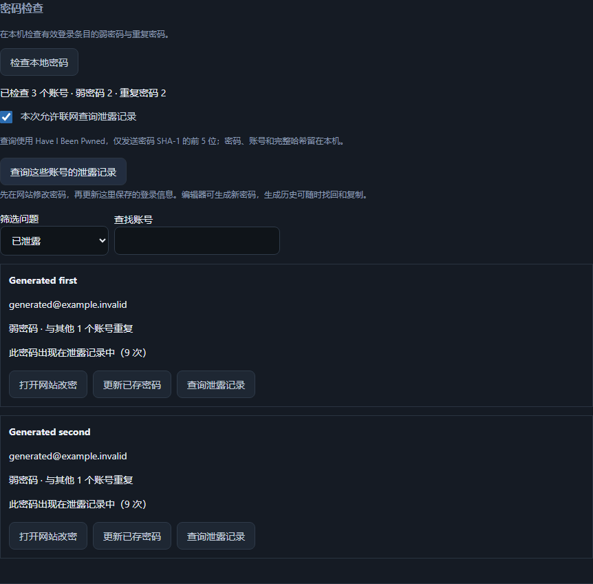

# Password health

Open **Security & recovery → Password check → Check local passwords**. Active login
entries with a password are checked entirely on the device. Archived, trashed and
non-login entries are excluded. Weak means fewer than 12 characters or a zxcvbn
score below 3. Passwords over the estimator's 72-character limit remain unscored;
reuse detection still includes them. Findings expose no passwords or hash values.

Filter weak/reused/exposed accounts, open the site's change-password page, then
update the saved login. The existing editor supplies generation and encrypted
generated-password recovery. Opening a site uses only its HTTPS origin and
`/.well-known/change-password`, discarding stored paths and query parameters.

Exposure checks require a fresh checkbox opt-in for the current visit and an
explicit lookup action. They send only a five-character SHA-1 prefix to
[Have I Been Pwned's range API](https://haveibeenpwned.com/API/v3#PwnedPasswords).
Response padding is requested. The full hash, password and username stay local;
comparison happens in the API process. Requests are sequential and reused
passwords share a result. Stop, navigation or vault lock stops remaining requests.
An already-dispatched HTTPS request cannot be recalled. Redirects are refused,
response size/time are bounded, and errors never mean an unexposed password.
Changing a password or locking during the lookup invalidates its result.

No findings, network consent, password hashes or exposure responses are stored.
The feature does not run on startup or while typing a password. zxcvbn-python
4.5.0 is bundled for offline evaluation; no dictionary is downloaded at runtime.

Validation: ten focused Python cases cover offline behavior, strict consent,
prefix-only transport, malformed/failed responses and edit/lock races. English
and Chinese generated-data renderer journeys cover the complete improvement
workflow, accessibility and scanned screenshots. Their network results and URL
opening are substituted; the API boundary has independent transport tests.
A fixed public test prefix also completed one actual padded HTTPS lookup.

