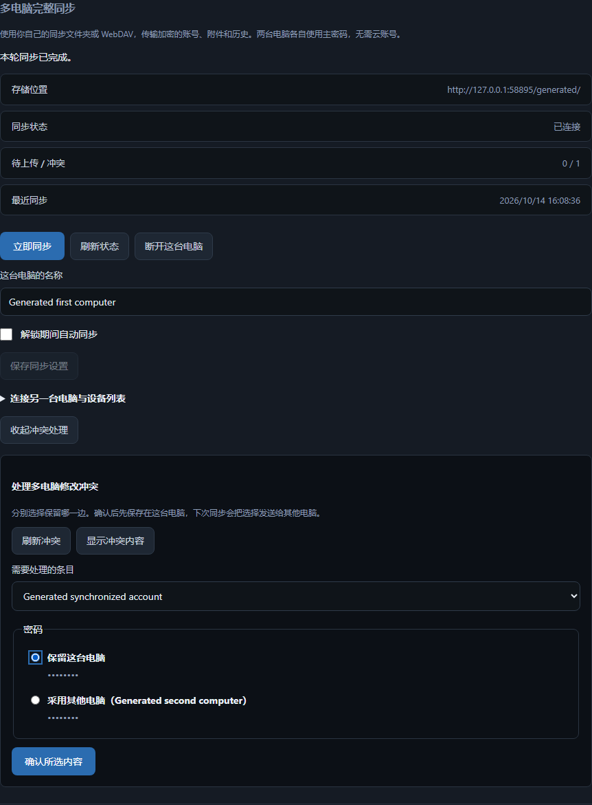

# Synchronize personal computers

The desktop Connections page supports a folder already synchronized by a drive
service/local network and an HTTPS WebDAV folder. No Vault Unified account is
needed. Both use the same authenticated encrypted record protocol.

## Setup and everyday use

1. Upgrade an old vault through Security & recovery first. On the first computer,
   choose Connections → Full vault sync between computers → Set up computer sync.
2. Choose Create, storage location and a device name. Automatic sync is unchecked
   initially. Preview, then confirm the connection. Select Sync now once.
3. Reveal or copy the connection code under Connect another computer. It contains
   the space's decryption key; transfer it only to another owned device. Revealed
   codes hide after 45 seconds or loss of focus. Clipboard copies use the existing
   45-second conditional cleanup.
4. On the other computer, create/unlock its own vault, choose Join and the same
   storage location, then paste that code. The preview shows local changes and
   conflicts. Cancel makes no vault/remote changes. Confirmation creates an
   encrypted backup before a merge that changes existing local content.
5. Sync manually, or enable Sync automatically while unlocked. The application
   retries about once a minute while unlocked, including when its main window is
   hidden. Automatic runs pause in editors, import, connections and conflict
   screens, and when a conflict needs a choice. Closing the app or locking stops
   new runs. Background requests do not extend the backend idle session.

Non-conflicting edits merge automatically. The conflict screen groups by entry,
shows each conflicting field, masks values until Reveal, and requires a choice
for every conflicting field in that entry. Deletion versus editing is a whole
entry choice. Confirmation writes locally; the next sync propagates the explicit
choice. A newer edit makes a previous review stale and requires refreshing it.

Network failure retains local data and the already-encrypted outbox. Restarts
retry the same ciphertext rather than assigning a new nonce to an old sequence.
An incomplete remote listing waits for predecessors. Device listings show the
known computers; deletion acknowledgements remain until all of them have seen the
deletion, with conservative retention afterward. Disconnect stops this computer
and removes its owned Windows credential record; it retains local entries and
remote ciphertext. Disconnect is not remote key revocation.

## Data and credentials

Entries, personal templates, attachments, TOTP, immutable entry histories,
generated-password history and unknown portable metadata travel encrypted.
Concurrent generated histories combine by immutable ID and keep their existing
100-record / 30-day retention. Other compound lists conflict as a field. External
connector bookkeeping, local Windows credentials and browser authorizations do
not replicate.

The only public installation file is a random identifier in the selected local
configuration directory. Connection configuration and replication state live in
the existing encrypted vault; the group key and WebDAV credentials live exclusively
in the approved Windows Credential Manager backend. There is no plaintext fallback.
A copied/recovered vault is not automatically connected: installation, vault ID
and path binding require a fresh device identity and explicit join on the new
computer. Preview secrets are session-scoped, expire in five minutes and clear on
lock. Credentials entered in a successful preview clear from the form.

The existing in-process vault lock now also covers legacy mutation and external
connector operations. A network merge uses an optimistic vault generation check;
ordinary edits cannot be overwritten. Legacy write failure restores the previous
in-memory entry view so automatic sync cannot publish an unsaved failed edit.
No additional distributed lock or persistent hash registry was introduced.

Limits and remote-history retention are documented in
[personal-sync-protocol.md](personal-sync-protocol.md). A user-selected WebDAV
service must support conditional creation. Loopback HTTP is allowed for an
explicit local service; remote HTTP and redirects are rejected.

## Validation

Generated independent vaults exercise folder and actual HTTP WebDAV transfers,
lost acknowledgement/restart, causal ordering, deletion conflict, explicit choice,
stale editor writes, recovery/new identity, credential cleanup and failed writes.
The bilingual renderer journey uses two real API processes, independent encrypted
profiles and actual Windows Credential Manager records. It covers preview cancel,
join/backup, simultaneous password edits, masked field choices, confirmation cancel,
manual and timed automatic sync, reconnection, disconnect and WebDAV interruption.
Accessibility and generated-artifact scanning passed; the masked Chinese screen
below was inspected. This renderer journey substitutes only native runtime-config
handoff; installed upgrades and physical multi-PC deployment are final acceptance.

