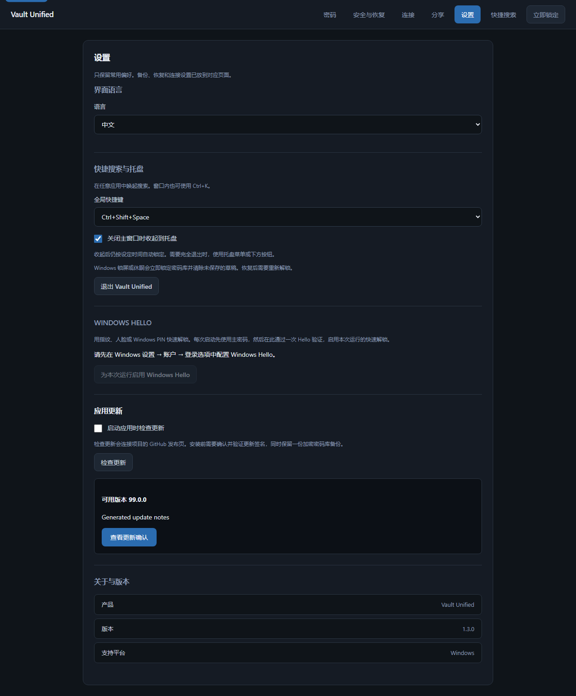

# Signed desktop updates / 签名更新

Settings provides a manual update check. Optional checking at application startup
defaults off, including when loading existing preferences. It contacts this
project's GitHub release manifest; it does not send account or vault contents.
Finding a version never starts an installation automatically.

Review the version and release notes, then confirm. Native code downloads the
installer, verifies its pinned Tauri signing key and signed version, creates a
verified, pinned encrypted backup using the existing backup manager, locks vault
sessions and launches the Windows installer. The renderer cannot choose a URL,
signing key or installer bytes. It has no generic updater plugin permissions.
Only matching-version release assets from this repository are accepted. HTTPS
is required, including redirects. Downgrades and unsigned-version signatures
are rejected. There is no additional account or update service.

在「设置 → 应用更新」手动检查，或主动开启启动检查。检查不会自动安装。
确认后会下载并验证签名，再保留加密备份、锁定密码库和启动安装程序。
下载或验签失败保持当前版本；备份失败停止安装。安装程序无法启动时，重新打开
应用并重试。更新后使用配套扩展，并从原密码库继续解锁。

## Signing and distribution

The public key is pinned in `tauri.conf.json`. The release private key is kept in
an ignored `secrets/updater` directory with access restricted to its Windows owner
and SYSTEM. It is not an extension signing key and never enters Git, screenshots,
logs or the sharing service. The same key is configured in this repository's
encrypted Actions secret for release builds. Keep an encrypted offline copy of this signing key;
future in-app updates require the same key. Build scripts consume
`TAURI_SIGNING_PRIVATE_KEY` and optional `TAURI_SIGNING_PRIVATE_KEY_PASSWORD`.

Tauri CLI 2.12.2 signs the installer with its application version in the trusted
comment. Updater 2.13.3 requires that value to equal the manifest version, so a
manifest cannot label an older signed installer as a new release. `latest.json`
must contain the actual installer URL and signature contents for each Windows
installer target. The release build produces matching installers, signatures,
manifest and personal-edition kit. Installed evidence is recorded in the
[v1.4.0 delivery record](release-record-v1.4.0.md). Draft release assets do not
enter the public update channel; promotion publishes the matching manifest.

## Verification

Rust tests run the actual Tauri updater against a loopback fixture with newly
generated signing keys: correct signature, changed bytes, wrong announced version,
missing signed version, old version, and signed noninstaller rejection. Only this
test's isolated configuration allows HTTP. Production transport requires HTTPS.
These transport/crypto tests use Tauri's test runtime; they are separate from the
actual Windows desktop lifecycle check.

Python tests verify native-only consent, a decryptable full-payload pinned backup,
all-session locking, and unchanged data/unlocked state when backup creation fails.
Renderer journeys verify Chinese/English opt-in controls, cancellation, explicit
installation and failure reporting. Native Windows checks cover default-off
preferences and installation rejection without confirmation. Packaged upgrade,
uninstall and owner Hello acceptance belong to final release validation.

Rollback retains the original vault and pre-update backup. Older payload clients
must not overwrite newer payload versions. To recover data, use the encrypted
backup/recovery workflow rather than copying plaintext between versions.

Reference: [Tauri updater](https://v2.tauri.app/plugin/updater/).
