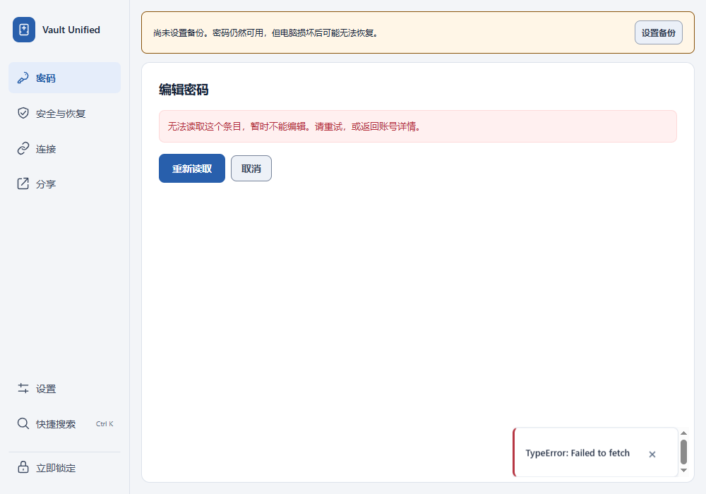
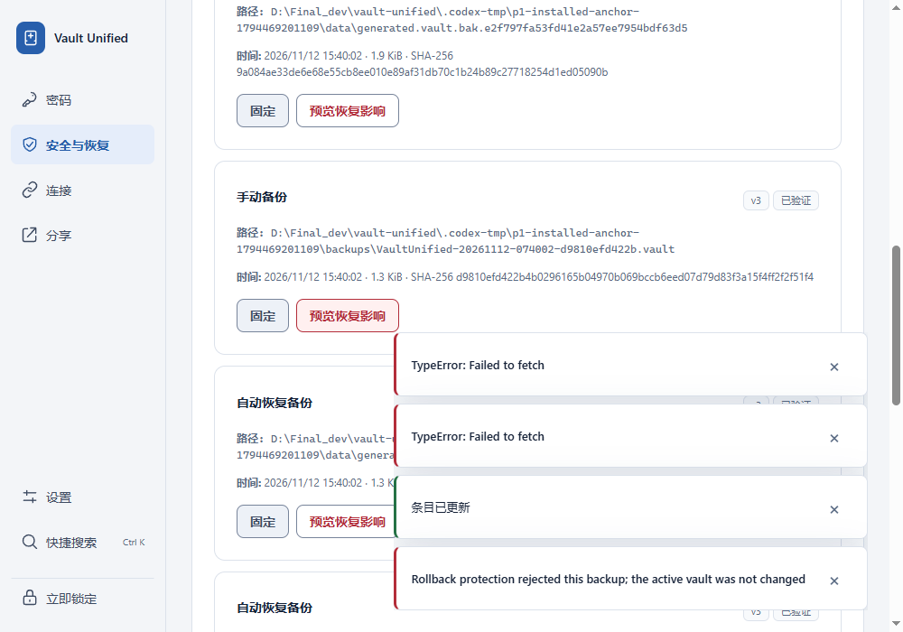

# P1 data-protection regression verification

Issues: #98 and #99. Base: `8c33a238b052f5836d2da9e3a17c5d71507dbe9f`.
All data was generated in isolated vault/config/WebView directories. No real
account, master password, token, recovery code, or attachment was used.

## Behavior and local regressions

- An existing entry's editor now requires both its full contents and history to
  load before exposing a form. Failure offers Retry loading and Cancel. Retry
  loads the complete saved state; late responses from abandoned loads are ignored.
- Restore preview and apply check the optional rollback anchor without advancing
  it. Rejected backups never replace the active file. Ordinary backup verification
  still accepts authenticated old backups, and unanchored restores still work.
- Restore payload validation happens before activation. The route no longer
  opens the restored vault after replacement, avoiding post-commit anchor failure.
  Generic storage failures no longer promise that the previous file is active.

Commands run from the repository root:

```powershell
.\.venv\Scripts\python.exe -m pytest tests/test_api_backups.py tests/test_backup_manager.py tests/test_v3_device_keyring.py -q
& ./scripts/run-ui-journeys.ps1 -TestFiles @('transactional-entry-editor.spec.ts', 'progressive-entry-editor.spec.ts', 'security-recovery-center.spec.ts', '--retries=0')
.\.venv\Scripts\python.exe scripts/scan_repository_secrets.py --repo-root .
git diff --check
```

Results: **28 Python tests and 17 renderer journeys passed**, no retries. The UI
runner also built/typechecked the renderer and scanned generated artifacts.
The existing Starlette/httpx deprecation warning remains.

Before the fix, both new editor cases failed because Save was still reachable.
The backend tests failed because restore preview accepted an older anchored
backup and apply replaced the active file before refusing to open it. Two
additional backend controls (read-only preview, normal v3 restoration) passed.
After the fix, monkeypatching only the new restore-anchor check to a no-op made
both rejection tests fail again; production files were not modified by this test.

## Installed Windows verification

Rebuilt the Python sidecar and the NSIS installer with the existing local build
configuration (`createUpdaterArtifacts: false`), installed it successfully, and
controlled its real WebView2 window and installed sidecar. This is a local unsigned
experience build, not a new signed public release.

| Check | Result |
| --- | --- |
| Fail only history GET during edit | No form/Save; encrypted file unchanged |
| Fail only full-entry GET during edit | No form/Save; encrypted file unchanged |
| Retry either failed read | Original title, password and notes loaded |
| Cancel after retry | No write |
| Save a changed title after retry | Real backend saved title and retained password/notes |
| Preview old backup with real Windows rollback record | Rejected; active file hash unchanged |
| Lock and unlock after rejected preview | Current entries still readable |
| Restore an unanchored backup | Confirmed, relocked, reopened with expected older contents |

No uncaught page errors were observed. The two deliberately interrupted editor
requests and rejected restore were expected failures, not a claim of zero network
errors. The test's unique Windows rollback record was removed afterward. Test
processes and debugging ports were closed, Chrome/Edge bridge registration was
restored and read back, and the normal installation was reopened.

Installed executable SHA-256:
`52aba5ff49127812c8240f15d53e4fbcb0643524e9353fae4c534c51ecf7d10f`.
Installed sidecar SHA-256:
`4116326481e2294cb504d60f9c5119c29fd488e51cb8da41dbf6739e865b9c0c`.
Installer SHA-256:
`cdea16a7d12eb5dae96b8d2eadc0d76d317601252e76bfd30d52e7accc442b54`.
The installed sidecar matches the build exactly. The installed desktop differs
from the final build-tree EXE only in Tauri's three-byte `UNK` → `NSS` bundle marker.

These are unedited screenshots of the installed WebView, without the native title
bar. The selected images were visually reviewed and contain no generated secret
values. The restore image includes the intentionally injected error toasts.




## Review and limits

Independent code review found no blocking issue. This is focused regression and
installed-app verification, not real novice usability approval, a full CI matrix,
or an exhaustive cross-process keyring fault audit. The seven P2 issues #100–#106
remain separate work. Per repository-owner instruction, merging uses these local
results and review and does not wait for CI. CI is not disabled.

Reverting the commit needs no data migration, but would reintroduce both P1 bugs;
retain current encrypted backups and avoid reverting while using affected flows.
