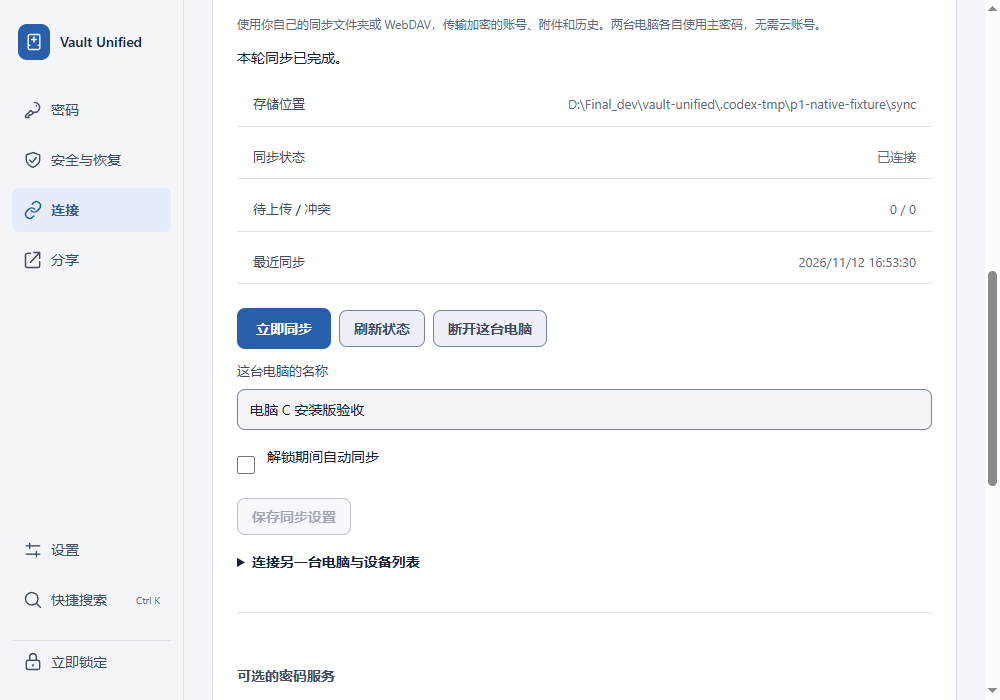
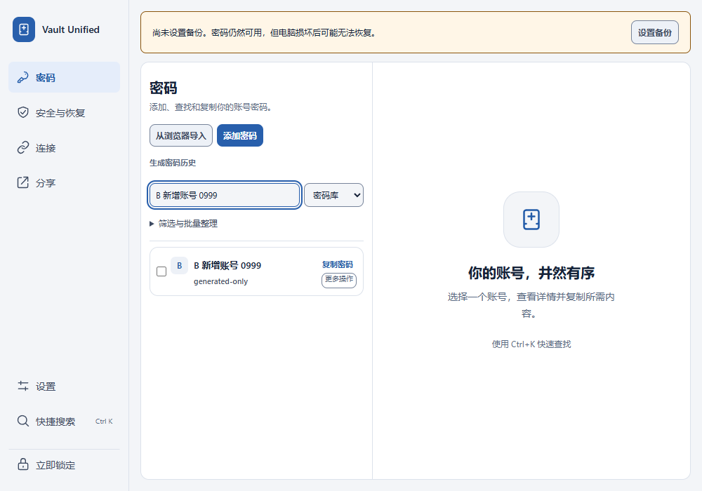
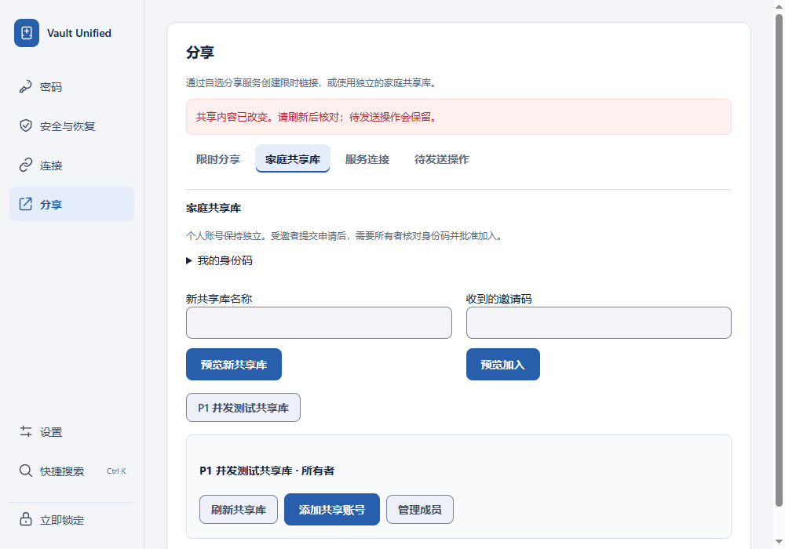
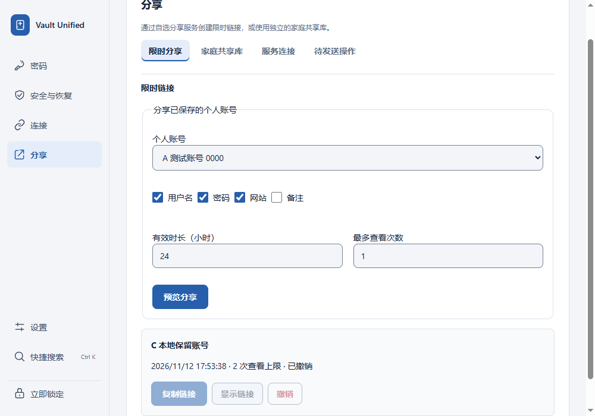

# P1 sharing state and causal synchronization validation

Scope: #109 and #110, based on `fdbede2b3d046521feac51c620cc2eb385f2dde5`.
The remaining audit findings are tracked separately as #111–119.

## Behavior and implementation

- **#109:** Sharing mutations capture the detached metadata and its generation together under the vault lock. The generation is captured first, and the existing commit/session checks still reject intervening writes. Network requests run outside the snapshot lock. A stale family refresh or pending-operation retry cannot replace a successfully committed new share with an older snapshot.
- **#110:** Download selection follows authenticated causal dependencies from each device's next record. It no longer fills the page with low sequence numbers that all wait for an excluded high-sequence predecessor. `receive()` still validates and applies records before durable advancement. Limits remain 1,000 records and 128 MiB per cycle; no timeout, protocol, encrypted data schema, or ACK policy changed.

## Regression evidence

The sharing regression failed on the original implementation for both refresh and retry: the stale operation succeeded instead of raising a transaction conflict. Tests exercise a real approved share inside the snapshot/generation gap, verify the encrypted vault after reopening, and verify that remote revocation still returns HTTP 410. Two additional real-thread tests cover changes during a paused network read/retry.

The original pagination implementation failed with a real encrypted 3,001-record folder: eight pages retained only 996 of 2,999 expected objects. Corrected integration fixtures were also run against the baseline download function loaded from Git in memory: normal synchronization imported only 7/23 objects, while join incorrectly reported missing changes. These are actual RED results, not inferred failures.

Final local checks:

```powershell
.\.venv\Scripts\python -m pytest tests/test_desktop_sharing.py tests/test_personal_sync_engine.py tests/test_personal_sync_connections.py tests/test_personal_sync_replica.py tests/test_personal_sync_protocol.py tests/test_personal_sync_transport.py tests/test_personal_sync_commit.py -q
# 65 passed
.\.venv\Scripts\pytest -q tests/test_personal_sync_pagination.py
# 11 passed
.\.venv\Scripts\python scripts/scan_repository_secrets.py --repo-root .
git diff --check
```

The 11 pagination cases cover the unchanged default limit, real-vault run and join, unchanged vault bytes on missing/tampered history, count and byte budgets, cycles, explicit resource exhaustion, and cancellation. Pytest reported only the existing Starlette/httpx deprecation warning. Independent static review found no blocking issue in the source and regression-test diff.

## Resource boundary

Dependency probes consume the page budget. If discovering a ready record exhausts that budget without any progress, the operation fails with an explicit resource-limit error. This is not a guarantee that an arbitrarily large dependency closure fits one cycle. A bounded extra blob can be read to discover that the byte budget would be exceeded; it is not retained. Missing records and authenticated causal cycles also fail closed. No partial join is applied to the user's vault.

## Installed Windows verification

**Passed**, using the installed NSIS build at the normal Windows application path and a disposable vault/profile. Sidecar build, TypeScript/Vite build, Rust release build and NSIS packaging all completed. No API responses were mocked: the sharing service ran on loopback, with its real signed requests and encrypted SQLite storage; a test middleware held one actual family-read response to control ordering.

| Case | Actual result |
| --- | --- |
| Join from the installed Connections UI | Prepared A's 1,999 accounts and B's 1,000 later accounts as 3,001 authenticated encrypted records using the real replication codec and FolderStore. The preview and confirmed connection yielded 3,000 entries, including C's existing local account, with zero conflicts. |
| Subsequent sync and reopening | Sync completed. Lock/unlock read back all 3,000 entries; searching for B's last account found it in the installed list. Disconnect succeeded without pending credential cleanup. |
| Sharing refresh versus a new share | Paused a real family-read response, created a share through preview/apply, then released the response. The installed UI's refresh returned 409 and displayed the changed-content notice; the new share remained visible. |
| Revocation after the refused refresh | Used the installed UI's revoke preview and confirmation. The card showed revoked and disabled further revocation. A real service read with the previously issued capability returned HTTP 410. |

The final complete run exited 0, with three acceptance groups and zero page-script errors. Early harness attempts corrected the manual-path disclosure step, waiting for the successful unlock response/render, and matching the revoked status inside its card. No application code, synchronization limit, or application timeout changed during that validation work.

Temporary synchronization credentials were removed by disconnect; the generated sharing credential was removed and absence verified after closing the test app. The test process exited, the WebView debug listener closed, Chrome/Edge native-messaging registrations were restored and read back, and the ordinary installation was reopened. User vaults were not used.

Build identity (SHA-256):

| Artifact | SHA-256 |
| --- | --- |
| NSIS installer | `e6aaeeb7860801df26e3d1ba10a2b59ee1aba283eab945eb5a140b4978f3bbbf` |
| Installed desktop executable | `65a2e0d1ab3a8ef2834a5dad02fcf56524d0b03b4d571b6eeb12330d586fa1f2` |
| Installed API sidecar | `5b19bbec3d5536534d503e8930790aee962c9e3aee191f6447dae5ac51e34f9d` |

The installed sidecar exactly matches this build. The installed desktop differs from the release build by exactly the expected three Tauri bundle-marker bytes (`UNK` to `NSS`). The installer and complete local evidence are under `C:\Users\chenshijie\Downloads\Vault-Unified-P1-sharing-sync`.

These are unedited 1000×700 captures of the actual installed WebView, without the native title bar. They were visually inspected and contain only generated account labels/status, no passwords, connection keys, sharing links, or administration tokens.






## Boundaries and rollback

All data and service credentials are generated in isolated test directories. The native test uses the installed executable and bundled sidecar, without Vite or an external development sidecar. The exact snapshot/generation gap is exercised by Python regression tests; the installed executable uses controlled real network delay, which is a different concurrency boundary.

This is an unsigned local experience build, not a new signed public release. It does not establish novice usability, real internet/WebDAV reliability, or resolution of #111–119. CI is not a merge gate for this task, as explicitly requested by the owner; no workflow is disabled. Reverting the commit restores prior scheduling and snapshot behavior without a file-format migration, but also restores the two bugs. Keep existing encrypted vaults and backups when rolling back.
