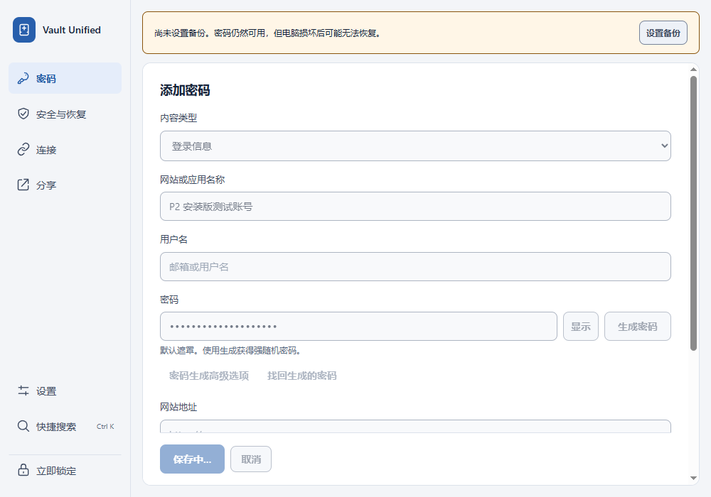
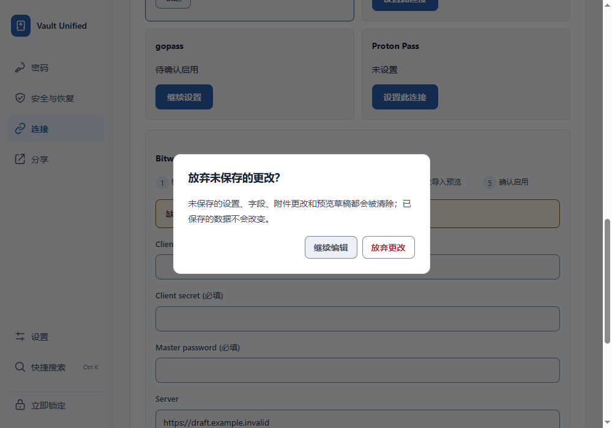
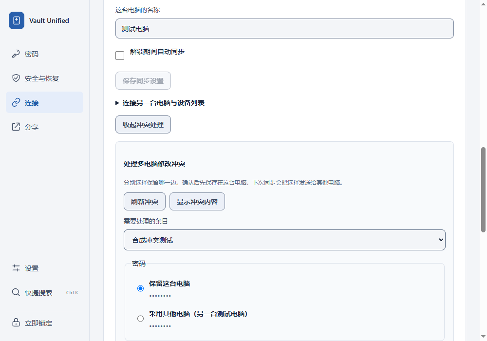
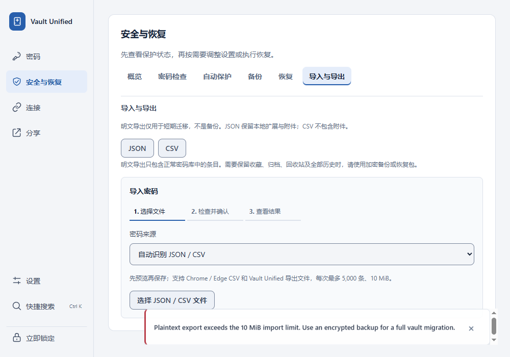

# P2 data and connection safety verification

Scope: issues #100–#106, based on main `e9363a0`. All checks used generated
accounts and isolated vaults. No real external credentials were submitted.

## Behavior and regression coverage

| Issue | Change and evidence |
| --- | --- |
| #100 | Import returns its digest/generation under the commit lock. A deterministic concurrent independent write makes Undo return 409 without deleting either entry or changing the vault bytes. Normal Undo still succeeds. |
| #101 | Save receipts bind the complete canonical request digest. Exact retries remain idempotent; changed drafts return 409 and remain in the editor. Concurrent same-ID creates cannot duplicate entries. |
| #102 | Entry and connection controls freeze while saving. Password generation and QR decoding must finish before Save can capture the draft; defensive submit guards also prevent bypassing the disabled button. |
| #103 | Connection configuration, advanced preferences, computer setup/settings, conflict choices and sync previews contribute to the existing navigation/lock/exit guards. Collapsing panels preserves drafts. |
| #104 | Conflict choices survive reveal/hide, timer, blur, collapse and switching objects within the same generation. A new generation clears stale choices. Confirmation submits only the current object's complete choices. |
| #105 | Hide replaces plaintext locally and invalidates pending requests. Failed masked reads and late reveal responses cannot redisplay values. Connection-code reveal has the same late-response protection. |
| #106 | JSON/CSV exports reject more than 5,000 entries or 10 MiB of final UTF-8 content before returning a download. Exact limits remain accepted. Errors recommend encrypted backup migration. |

Commands run from the repository root:

```powershell
./.venv/Scripts/python -m pytest -q tests/test_api_entries.py tests/test_import_flow.py tests/test_transfer_limits.py tests/test_personal_features.py tests/test_personal_payload.py tests/test_organization.py tests/test_duplicate_merge.py tests/test_browser_daily_use.py
& ./scripts/run-ui-journeys.ps1 -TestFiles @('p2-connection-safety.spec.ts', 'transactional-entry-editor.spec.ts', 'beginner-information-architecture.spec.ts', 'sync-item-preview.spec.ts', '--retries=0')
& ./scripts/run-ui-journeys.ps1 -TestFiles @('generator-recovery.spec.ts', 'personal-sync.spec.ts', 'totp-workflow.spec.ts', '--retries=0')
& ./scripts/run-ui-journeys.ps1 -TestFiles @('personal-sync.spec.ts', '--retries=0')
./.venv/Scripts/python scripts/scan_repository_secrets.py --repo-root .
git diff --check
```

Results: **97 Python tests**, **22 focused renderer journeys** and **7 existing
real-sidecar journeys** passed. Renderer runs include TypeScript/Vite builds and
generated-artifact scans. The first real-sidecar run passed both generator cases,
TOTP and ordinary English sync, but three sync cases tried to leave while settings
were still saving. The existing test treated a disabled Save button as completion;
it now waits for the successful settings response, enabled controls and clean
baseline. All four English/Chinese normal/delayed sync cases then passed without
retries or longer timeouts. Existing dependency and Vite bundle-size warnings remain.

The nine initial renderer regressions failed against an isolated copy of the base
source. Independent static review found two additional in-flight draft mutations
(password generation and QR import); both new tests failed before the follow-up
fix and passed afterward. Backend RED evidence includes the destructive undo
interleave, changed-payload retry, concurrent duplicate create and export boundaries.

## Installed Windows acceptance

Rebuilt the Python sidecar and NSIS installer, installed successfully, and tested
the actual installed executable, WebView2 and bundled sidecar. This is an unsigned
local experience build, not a new signed public release. Test data/config/bridge
and WebView profiles were isolated from the ordinary installation.

Eight groups passed with no uncaught page errors:

1. Normal import Undo succeeds; Undo after an independent save returns 409 and
   preserves both entries and encrypted file bytes. The exact internal lock
   interleave is covered by the Python regression, not simulated inside the EXE.
2. A delayed real password-generation response keeps Save disabled.
3. A delayed real entry-commit response freezes editor fields.
4. A real successful commit whose response is dropped, followed by an edited
   retry, returns 409, retains the new draft and leaves the first save intact.
5. Unsaved connection setup blocks navigation; unsaved computer setup blocks
   manual lock until the user chooses what to do.
6. A controlled delayed connection-save response freezes fields and blocks
   navigation. That PUT was stubbed to avoid saving external credentials.
7. Synthetic conflict responses verify retained selection after reveal/hide and
   45-second expiry, local masking with the masked endpoint unavailable, and
   rejection of a reveal response arriving after blur. The installed renderer is
   real; this group does not claim a physical two-computer sync test.
8. Two real entries with eight valid 1-MiB attachments produce an export-limit
   error, no JSON download and no active-file change. A full encrypted backup of
   the same vault succeeds and verifies.

The test process and debugging port were confirmed closed. Chrome/Edge native
bridge registrations were restored and read back, and the ordinary app reopened.

SHA-256:

- Installed desktop: `883ae241f0ed494c706845e9fd0149af4db77e1e741074f5bca7facf034b7d68`
- Installed sidecar: `0d9fd62130c1278daa875417b70bd5bfb015df55fb80f325bb3b9bc276ef32c6`
- NSIS installer: `320196e9044a16e4524dee5e29eb6a2f59b9585450b972bb10839aa3be3f604e`

The installed sidecar matches the build exactly. The desktop differs from the
build-tree EXE only in Tauri's three-byte `UNK` to `NSS` bundle marker.

These unedited screenshots show the installed WebView at 1000 × 700, without the
native title bar. They were visually inspected and contain no secret values.






## Review and limits

Separate read-only backend and frontend reviews found no remaining blocking
findings after the generation/QR follow-up. These are agent reviews, not a human
novice-usability approval. Native exit behavior was checked by code review;
installed manual-lock guarding was exercised. Windows Hello and real external
provider accounts were not tested. Renderer sync journeys use isolated local
sidecars and generated stores, not separate physical computers.

Export checks cover the aggregate entry/byte limits. Existing per-field import
validation and CSV attachment omission are unchanged; this is not a claim that
every possible vault payload round-trips through plaintext export. No storage
format change or data migration is introduced. Reverting the commit restores the
old behavior without requiring a vault conversion, but reintroduces these bugs.

CI is not a merge gate for this change at the user's explicit request; local
results and installed acceptance are the verification evidence.
