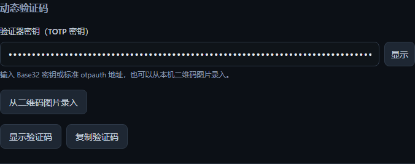

# 动态验证码 / Verification codes

打开条目的「更多选项 → 动态验证码」，输入网站提供的 Base32 密钥、
`otpauth://totp/` 地址，或选择本机二维码图片。支持 PNG、JPEG、WebP，
最大 4 MiB；二维码在本机识别。录入后先保存条目，取消会保留原来的密钥。

「显示验证码」显示当前验证码和倒计时，过期自动更新，失焦或三十秒后
隐藏。「复制验证码」复制已保存条目的当前代码，在到期时或最多四十五秒后
清除剪贴板；只有剪贴板内容仍与复制的代码相同才会清除。

浏览器扩展中的匹配账号可点击「填入验证码」。网站需要有唯一、可见的
验证码输入框（`autocomplete="one-time-code"`）；多个候选或无法识别时，
可从桌面端复制。不会提交表单。默认匹配精确主机、协议和端口，包括区分
`example.com` 与 `www.example.com`。归档和回收站中的账号不参与填充。

Open an entry's **More options → Verification codes**. Enter a Base32 key or
standard otpauth TOTP URI, or read a local QR image. Save to keep the draft.
Show the current code/countdown or copy a saved entry's code. Revealed codes hide
on blur or after thirty seconds. Expired codes refresh automatically. The browser
extension can explicitly fill one unambiguous OTP field for a matching account;
the authenticator secret stays in the encrypted desktop vault.

## Supported format and validation

- [RFC 6238](https://www.rfc-editor.org/info/rfc6238/): SHA-1, SHA-256 and SHA-512,
  six/eight digits, default thirty-second period; custom positive periods supported.
- [Key URI format](https://github.com/google/google-authenticator/wiki/Key-Uri-Format):
  TOTP only. HOTP counters, duplicate URI parameters and invalid keys are rejected.
- QR decoding uses the bundled [jsQR](https://github.com/cozmo/jsQR) library with
  no upload or external image request. Keys and code previews are never persisted
  outside the existing encrypted entry save.
- RFC Appendix B vectors, API authorization/lock/origin refusal, copy expiry,
  renderer QR setup/cancel/live rollover and extension ambiguity/expiry are tested.
  The native restart journey also fills a real browser OTP field using generated
  data. Installer-level Chrome/Edge acceptance remains part of final delivery.

## Rollback

Reverting this increment leaves the existing encrypted `totp_secret` field intact.
Older source versions retain raw keys/URIs but lack this code-generation interface.
