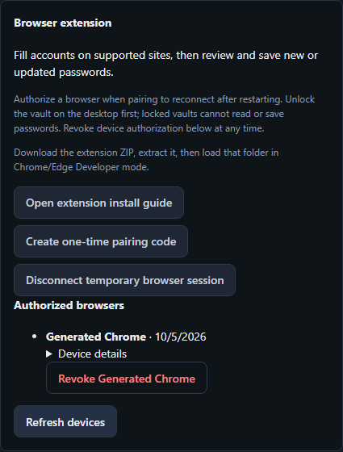

# Trusted browser connections (development source)

The source adds optional persistent browser authorization for v3 vaults. It is
not part of the published v1.3.0 installer. Use matching desktop and extension
versions. Session-only pairing remains available by unchecking authorization.

## User workflow

1. Start and unlock the desktop. Generate a one-time code in Connections.
2. Enter its address and code in the extension. Leave browser authorization
   selected and give the browser a recognizable name.
3. Subsequent openings find the running desktop through native messaging. After
   restarting either app, unlock the same vault and reconnect without a new code.
4. Connections lists authorized browsers. Revoking one requires confirmation and
   immediately denies its subsequent requests, including existing access tokens.
   Forget pairing in the extension also revokes the device, even while locked.

First pairing requires the displayed address because Chrome/Edge will not allow
a native host until that extension's exact origin has been registered. Native
discovery is configured by the desktop executable; starting only the Python API
does not install a browser host. If native messaging is disabled by policy,
the reconnect screen accepts the new address shown by the desktop, retaining
the device's authorization. Discovery never opens a vault or launches the app.

## Trust and storage boundaries

- The extension creates an ECDSA P-256 signing key. Its non-exportable private
  CryptoKey is stored in the extension's IndexedDB together with its public key,
  opaque device ID and last local address. Access tokens remain in
  `chrome.storage.session`; account data and draft passwords are never persisted
  by the extension. Non-exportability does not protect a compromised extension
  or operating-system account from invoking the key.
- A one-time pairing code authorizes enrollment. The public key, extension
  origin, vault path/identity/key identity and device name are protected by the
  approved Windows Credential Manager backend. There is no plaintext fallback.
  The store supports up to 16 browser identities per configuration directory.
- Each reconnect signs a server-created, single-use challenge valid for 60
  seconds. Its message binds the protocol, action, device, extension origin and
  random challenge ID. Resume and revoke proofs are not interchangeable.
- A successful proof can only access an already-unlocked matching vault. It
  cannot unlock the desktop, change idle deadlines or access a different vault.
  Status polling also leaves the idle deadline unchanged. Device authorization
  persists until revoked; access tokens expire after at most 12 hours.
- Revocation deletes the device credential before updating the index. A failed
  index update cannot restore access. Invalid/missing credentials and storage
  failures deny authorization. Authorization is local to this Windows account;
  migrating a vault requires pairing again on the new computer.
- Native messaging exposes only protocol, loopback address and process instance
  ID. It never receives or returns bootstrap secrets, pairing codes, browser
  tokens or vault passwords. Bounded length-prefixed JSON and exact registered
  extension origins are enforced. The host checks the running instance before
  returning an address, rejecting stale runtime files.
- Chrome/Edge native-host registration uses the current user's registry and
  points at the desktop executable. Existing production browser profiles are
  never used in tests. Removing credentials revokes access independently of host
  registration; complete installer registration cleanup is tracked with the
  distribution/upgrade work in row 12 of the product plan.

## Verification and rollback

`tests/test_browser_trust.py` exercises cryptographic proofs, replay, wrong
origin/key/action, expiry, locking, vault binding, revocation and credential-store
failure. The Windows integration case uses an isolated credential namespace.
`tests/test_browser_discovery.py` exercises public runtime data and registration
without modifying real browser keys. Rust tests cover framing and origin checks.

After building the debug desktop executable, run:

```powershell
node apps/desktop/tests/live/browser-trust-restart.mjs
```

This uses the actual native executable, Windows credential store, Chromium
extension and API, restarts both processes with a different port, checks locked
denial and real filling, then revokes the device. The only extension substitution
is a unique test host name so no production registry key is touched. Generated
credentials, temporary browser profiles and scoped registry/credential entries
are cleaned up; no network trace is recorded. This does not replace packaged
installer or independent human acceptance.

Reverting the feature leaves the vault format unchanged. Older clients cannot
use persistent authorization and require their original session pairing. Revoke
devices before reverting if authorization should not survive a later upgrade.

Generated device-list example (no credentials or vault contents):


