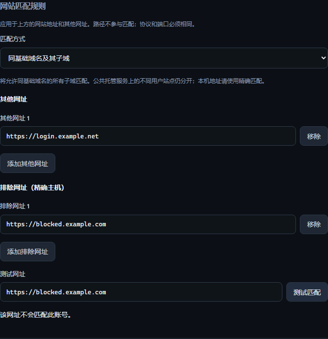

# 网站匹配规则 / Website matching rules

编辑登录信息，在「更多选项 → 网站匹配规则」中设置同一账号可用于哪些网址。
默认使用精确主机，并要求协议与端口相同。`example.com` 和 `www.example.com`
默认分开；网址路径不参与匹配。

- **其他网址**：添加同一账号使用的其他网站，每项最多二十个。
- **同基础域名及其子域**：主动允许同一注册域名下的子域，例如
  `login.example.co.uk` 与 `accounts.example.co.uk`。`other.co.uk` 不匹配，
  `owner.github.io` 与 `other.github.io` 也保持分开。协议和端口仍须相同。
- **排除网址**：指定不允许匹配的精确主机、协议和端口，优先于其他规则。
- **测试匹配**：用当前草稿检查一个网址；只在本机判断，不打开该网址、不保存。

保存后，扩展的账号候选、密码填充、验证码填充及账号更新共用这套规则。
归档、回收站中的条目仍不参与填充。其他网址也可在密码库搜索中找到。

In **More options → Website matching rules**, add alternate websites, select
exact-host or base-domain matching, and exclude specific origins. Test the draft
without saving or visiting the address. Save applies the complete entry; cancelling
keeps prior rules. Public hosting tenants remain separate, and scheme/port must
always match. Exact mode is required for IP addresses and local/unknown domains.

## Implementation and compatibility

Rules use optional encrypted `vault_unified:website_rules` v1 metadata in payload
schema 3. New clients preserve omitted rule fields from older import files and
remote connector refreshes. Rules are available in field history and duplicate
merge review. JSON transfer v3 and the CSV `website_rules` column round-trip them;
JSON v1/v2 imports remain readable. Old vaults need the existing explicit upgrade.

Host normalization uses IDNA; base-domain checks use
[tldextract](https://github.com/john-kurkowski/tldextract) with its bundled public
and private suffix snapshot. `suffix_list_urls=()` and `cache_dir=None` disable
network lookup and disk cache. The snapshot travels with desktop updates. URLs
with embedded credentials, backslashes, control characters or invalid ports are
refused; unrecognized entry rules do not produce browser candidates.

Generated-data checks cover `co.uk`, private `github.io` tenants, PSL wildcard and
exception behavior, Unicode/punycode, IPv6, scheme/port changes, exclusions, old
imports, history/merge/round trips and failed writes. Real renderer and native
Chromium extension journeys verify extra-website matching and filling. Final
installed Chrome/Edge lifecycle remains part of delivery acceptance.

## Rollback

Reverting the increment retains the encrypted metadata in schema-3 vaults. Older
source versions use the primary URL's exact match until this version is restored.
Do not downgrade the vault payload or use an old plaintext export to replace it.
